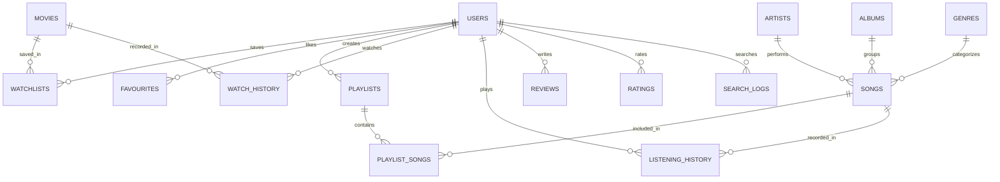

# 🎬 HIMSTREAMX – Cinematic OTT + Regional Music Streaming Platform

> **Developed by Himanshu Prajapati (2026)**  
> *A Production-Quality Full-Stack OTT & Multilingual Music Streaming Prototype.*

---

## 📌 1. Project Overview & Architecture

**HIMSTREAMX** is a unified streaming platform combining 4K UHD movie & web series discovery, a global persistent regional music player, personal user library management, real-time telemetry analytics, and an administrative control platform.

### Dual-Mode Resiliency Engine
The application operates with a **zero-breakage dual-mode architecture**:
1. **REST API Mode (Connected)**: Full state synchronization with a high-performance **FastAPI** backend and an ACID-compliant **SQLite** database (`backend/himstreamx.db`) supporting 17 relational tables.
2. **Offline Fallback Mode (Autonomous)**: If the backend is offline or the frontend is launched via `file:///` or standalone static hosting, the frontend client seamlessly activates its autonomous local persistence engine (`localStorage`), preserving all player controls, watchlist, favorites, playlists, and recommendations without throwing console errors or halting playback.

---

## 🚀 2. Key Features Checklist

- [x] **Universal YouTube Search & Official Embedded IFrame Playback**:
  - Full-featured search for *"Bhojpuri song"*, *"Hindi song"*, *"Punjabi song"*, *"Haryanvi song"*, *"Rajasthani song"*, *"English song"*, *"Arijit Singh"*, *"Bhojpuri movie"*, and *"music video"*.
  - Strictly compliant with YouTube Terms of Service: Uses official YouTube Data API v3 and official YouTube Embedded IFrame Player.
  - Zero scraping, zero MP3/audio extraction, zero unauthorized downloads.
  - Responsive 16:9 player modal with playback controls and graceful fallback for embed-restricted videos (YouTube error 101/150).
- [x] **VIP Subscription Pass & Theatrical Cinema Hall Movies**:
  - Exclusive access to cinema hall blockbusters (*Kalki 2898 AD, Jawan, Animal, Stree 2, Pushpa 2, Salaar*).
  - 4 Subscription Tiers: Monthly (₹199), Quarterly (₹499), Annual (₹999), and Lifetime Patron (₹1,499).
  - Verified UPI Payment Gateway with instant UTR verification:
    - **UPI ID**: `7084468661@pytes`
    - **Support Mobile**: `+91 7084468661`
    - **Scan & Pay QR**: `/qr.png`
- [x] **Director Himanshu Prajapati Private Profile & Telemetry Vault**:
  - Password-protected executive vault unlocked exclusively via master password: `Him@90`.
  - Displays Founder credentials, official photo (`/Himanshu photo.png`), contact coordinates (`+91 7084468661`, `himanshuprajapati6643@gmail.com`), UPI ID (`7084468661@pytes`), and interactive telemetry bar graphs (growth curve, regional language distribution, tech stack scores).
- [x] **Smart Music Recommendations**: Multi-factor scoring (Genre 40%, Language 35%, Artist 25%, Popularity 10%) providing dynamic shelves: *Recommended For You*, *Because You Listened To [Track]*, *Similar Songs*, *Trending Near You*, *Popular In Your Language*, and *Discover New Music*.
- [x] **Smart Movie Recommendations**: Dynamic shelves: *Recommended Movies*, *Because You Watched [Title]*, *More Like This*, *Trending Movies*, and *Top Rated*.
- [x] **Real-Time Login Notification Alert to Admin Email**: Whenever any user logs in or registers on HIMSTREAMX, an asynchronous security alert email is dispatched to `himanshuprajapati6643@gmail.com` with client IP, user agent, timestamp, role, and details, logged permanently to `backend/security_audit.log`.
- [x] **Advanced Global Music Player**:
  - Persistent bottom mini-player surviving page and tab navigation.
  - Full-screen vinyl rotating expanded player with animated real-time audio visualizers.
  - Slide-out reorderable play queue.
  - Shuffle, Repeat modes (`off`, `all`, `one`), playback speed controls (`0.5x` to `2.0x`).
  - Seek scrubber with duration calculation and live buffering indicators.
  - Keyboard shortcuts (`Space`, `ArrowLeft`/`ArrowRight`, `ArrowUp`/`ArrowDown`, `M`, `L`, `N`, `P`, `F`, `S`, `R`, `Esc`).
  - Studio master audio badge and synchronized/formatted lyrics panel preview.
  - Web Audio Synthesizer fallback ensuring uninterrupted playback even on unhosted audio streams.
- [x] **Universal Data-Driven Discovery Hub**:
  - **19+ Music Categories & Moods**: Hindi, Bhojpuri, Punjabi, Haryanvi, Rajasthani, Bengali, Marathi, Gujarati, English, South Indian, Devotional, Romantic, Sad, Party, DJ/Remix, Folk, Classical, Lo-fi, Instrumental.
  - **11+ Movie Genres & Origins**: Bollywood, Regional Indian Cinema, International Cinema, Action, Comedy, Thriller, Horror, Romance, Sci-Fi, Drama, Animation.
- [x] **User Account & Media Dashboard (`#userDashboardModal`)**:
  - Profile overview with tier badge and live activity counts.
  - Personal Watchlist with 1-click removal.
  - Liked Songs collection with instant row playback.
  - Custom Playlists: 1-click creation with curated presets (*Morning, Workout, Party, Relax, Bhojpuri Hits, Punjabi Hits*), rename, delete, add/remove songs, and 1-click **Play All** / **Shuffle Play**.
  - Continue Watching & Continue Listening with progress bar and exact timestamp resumption.
  - Community Reviews & Star Ratings history.
- [x] **Admin Management Hub (`#adminDashboardModal`)**:
  - Live metrics: Total users, catalog movies, songs, playlists, peak bandwidth, and top searched query telemetry.
  - Catalog CRUD: Add new movies/series and publish new songs with language, genre, and artwork tags.
  - User moderation: Toggle user accounts between `active`, `suspended`, and `banned`.
  - Review moderation: Approve, monitor, or delete community reviews.
  - Global system announcement broadcaster.
- [x] **Enterprise Security**:
  - PBKDF2-HMAC-SHA256 password hashing (120,000 iterations).
  - Cryptographic JSON Web Tokens (JWT) with HS256 signature verification.
  - Role-Based Access Control (RBAC) with strict `ADMIN` route guards.
  - In-memory sliding-window rate limiter protecting auth routes from brute-force attempts.
  - SQL injection protection via parameterized database queries.
  - Sanitized error handling.

---

## 🛠️ 3. Technology Stack

- **Frontend**:
  - Semantic HTML5, CSS3 Custom Properties (Dark Cinematic Theme, Neon Cyan `#56e2ea` & Ruby Red `#e50914` accents).
  - Modern ES6+ Modular JavaScript (`api.js`, `player.js`, `movies.js`, `music.js`, `discovery.js`, `authAdmin.js`, `search.js`, `app.js`).
  - Web Audio API (Synthesizer fallback oscillators, gain nodes, and real-time visualizers).
  - Font Awesome 6 Pro icons.
- **Backend**:
  - Python 3.14 / 3.11+.
  - **FastAPI**: High-performance asynchronous REST API framework.
  - **Uvicorn**: Lightning-fast ASGI production web server.
  - **SQLite3**: Relational SQL engine with foreign keys (`PRAGMA foreign_keys = ON;`).
  - **Pydantic v2**: Type validation and request/response serialization.
  - **PyJWT**: Secure token generation and signature verification.
  - **smtplib & email.mime**: Standard library background email notification dispatch.

---

## 📁 4. Project Folder Structure

```
f:\HIMSTREAMX\
├── backend/
│   ├── .env                       # Local secrets (JWT key, SMTP, origins)
│   ├── .env.example               # Environment variables configuration template
│   ├── config.py                  # Pydantic BaseSettings environment loader
│   ├── database.py                # 17 Relational SQLite tables & index definitions
│   ├── himstreamx.db              # Active SQLite database file
│   ├── models.py                  # Pydantic v2 schemas for all requests and responses
│   ├── notifications.py           # Background email notification dispatcher & audit logger
│   ├── requirements.txt           # Python backend dependencies
│   ├── security.py                # PBKDF2 hashing, JWT issuance & RBAC guards
│   ├── security_audit.log         # Persistent record of all login & registration events
│   ├── seed.py                    # Auto-seeder with default Admin, Movies, and Songs
│   ├── server.py                  # FastAPI server entrypoint & static assets mount
│   ├── test_api.py                # Comprehensive 20-suite end-to-end test runner
│   └── routes/
│       ├── admin.py               # Platform analytics, User/Catalog CRUD & review moderation
│       ├── artists.py             # Artist bios, tracks, and monthly listener stats
│       ├── auth.py                # User login, registration, /me stats & login alert triggers
│       ├── movies.py              # Movie/Series catalog, filters, details & trailer links
│       ├── playlists.py           # User playlists, CRUD, add/remove song ordering
│       ├── recommendations.py     # Smart explainable recommendations for music & movies
│       ├── search.py              # Multi-facet search engine & query telemetry logger
│       ├── songs.py               # 21-category regional music catalog & play tracking
│       └── user_library.py        # Watchlist, Liked songs, watch/listening history & reviews
├── data/
│   ├── moviesData.js              # Client fallback movie catalog (10+ blockbusters)
│   └── songsData.js               # Client fallback music catalog (23+ regional tracks)
├── js/
│   ├── api.js                     # Unified API Client Service (Dual-Mode online/offline)
│   ├── app.js                     # SPA Navigation, View routing & DOM lifecycle
│   ├── authAdmin.js               # User dashboard modal, Auth engine & Admin tables
│   ├── discovery.js               # Data-Driven Universal Discovery Engine (30 categories)
│   ├── movies.js                  # Cinema player, detail modal & watchlist sync
│   ├── music.js                   # Regional grid renderer, genre pills & queue
│   ├── player.js                  # Persistent global music player & likes sync
│   └── search.js                  # Search autocomplete & filter bar
├── Himanshu photo.png             # Creator branding photo
├── qr.png                         # UPI / Support payment badge
├── index.html                     # Responsive OTT + Music UI with Dashboards
├── style.css                      # Core cinematic dark UI stylesheet
├── style-music.css                # Music, player, user dashboard & admin table styles
└── README.md                      # Comprehensive project documentation
```

---

## 🗄️ 5. Database Schema & Tables

The SQLite database (`backend/himstreamx.db`) contains **17 relational tables**:



### Table Breakdown

1. **`users`**: `id`, `name`, `email` (UNIQUE), `password_hash`, `role` (`USER`/`ADMIN`), `avatar`, `plan`, `status` (`active`/`suspended`/`banned`), `created_at`, `updated_at`.
2. **`movies`**: `id`, `title`, `type` (`movie`/`series`), `year`, `rating`, `genres` (JSON), `backdrop`, `poster`, `synopsis`, `cast_list` (JSON), `director`, `trailer_url`, `duration`, `is_trending`, `is_top10`, `created_at`.
3. **`songs`**: `id`, `title`, `artist`, `artist_id`, `album`, `album_id`, `language`, `genre`, `year`, `duration`, `duration_sec`, `cover_image`, `audio_url`, `category`, `popularity`, `play_count`, `is_trending`, `created_at`.
4. **`artists`**: `id`, `name`, `language`, `avatar`, `bio`, `monthly_listeners`, `created_at`.
5. **`albums`**: `id`, `title`, `artist_id`, `release_year`, `cover_image`, `created_at`.
6. **`genres`**: `id`, `name`, `type` (`movie`/`music`), `icon`.
7. **`playlists`**: `id`, `user_id`, `title`, `description`, `is_public`, `cover_image`, `created_at`, `updated_at`.
8. **`playlist_songs`**: `id`, `playlist_id`, `song_id`, `order_index`, `added_at` (UNIQUE constraint on `playlist_id` + `song_id`).
9. **`watchlists`**: `id`, `user_id`, `movie_id`, `added_at` (UNIQUE constraint on `user_id` + `movie_id`).
10. **`favourites`**: `id`, `user_id`, `item_type` (`song`/`movie`), `item_id`, `added_at` (UNIQUE on `user_id` + `item_type` + `item_id`).
11. **`watch_history`**: `id`, `user_id`, `movie_id`, `progress_percent`, `progress_seconds`, `completed`, `watched_at`.
12. **`listening_history`**: `id`, `user_id`, `song_id`, `duration_played_sec`, `completed`, `listened_at`.
13. **`ratings`**: `id`, `user_id`, `item_type`, `item_id`, `score`, `created_at`.
14. **`reviews`**: `id`, `user_id`, `item_type`, `item_id`, `review_text`, `rating`, `status` (`pending`/`approved`/`rejected`), `created_at`.
15. **`search_logs`**: `id`, `user_id`, `query`, `search_type`, `searched_at`.
16. **`announcements`**: `id`, `admin_id`, `title`, `message`, `is_active`, `created_at`.

---

## 🌐 6. REST API Endpoint Directory

### Authentication & Profiles (`/api/auth`)
- `POST /api/auth/signup`: Create a new user account (returns JWT; triggers admin login alert).
- `POST /api/auth/login`: Authenticate with email/password (returns JWT; triggers admin login alert).
- `GET /api/auth/me`: Current user session and activity statistics.
- `PUT /api/auth/profile`: Update name, avatar, or password.
- `POST /api/auth/logout`: Revoke session.

### Movies & Web Series (`/api/movies`)
- `GET /api/movies`: Query catalog with filters (`type`, `genre`, `year`, `search`).
- `GET /api/movies/{id}`: Detailed movie information, trailer ID, and synopsis.
- `GET /api/movies/{id}/similar`: Recommended similar titles by genre overlap.

### Songs & Audio Streaming (`/api/songs`)
- `GET /api/songs`: Filter by `language`, `genre`, or `category`.
- `GET /api/songs/{id}`: Single song metadata and stream source.
- `POST /api/songs/{id}/play`: Increment track stream counter & telemetry.

### Artists (`/api/artists`)
- `GET /api/artists`: List featured artists with monthly listener statistics.
- `GET /api/artists/{id}`: Artist biography and photo.
- `GET /api/artists/{id}/songs`: All tracks by the specified artist.

### Playlists (`/api/playlists`)
- `GET /api/playlists`: Fetch public playlists and user custom playlists.
- `GET /api/playlists/{id}`: Playlist detail with ordered tracklist.
- `POST /api/playlists`: Create a new playlist (Requires Auth).
- `PUT /api/playlists/{id}`: Rename or update description.
- `DELETE /api/playlists/{id}`: Delete user playlist.
- `POST /api/playlists/{id}/songs`: Add track to playlist.
- `DELETE /api/playlists/{id}/songs/{song_id}`: Remove track from playlist.

### Smart Recommendations (`/api/recommendations`)
- `GET /api/recommendations/music`: Multi-factor music recommendations (*Recommended For You*, *Because You Listened To*, *Similar Songs*, *Trending Near You*, *Popular In Your Language*, *Discover New Music*).
- `GET /api/recommendations/movies`: Multi-factor movie recommendations (*Recommended Movies*, *Because You Watched*, *Similar Movies*, *Trending Movies*, *Top Rated*).

### User Library & History (`/api/library`)
- `GET /api/library/watchlist`: Fetch user's saved movies and series.
- `POST /api/library/watchlist/toggle`: Add/remove title from watchlist.
- `GET /api/library/liked-songs`: Fetch user's favorite songs.
- `POST /api/library/favourites/toggle`: Heart/unheart any song or movie.
- `GET /api/library/history/watch`: Watch history with timestamp resumption.
- `POST /api/library/history/watch`: Record movie playback progress.
- `GET /api/library/history/listening`: Recently listened audio stream history.
- `POST /api/library/history/listening`: Record audio playback event.
- `GET /api/library/reviews/my`: View all reviews posted by current user.
- `POST /api/library/reviews`: Submit a rating and review for any title or song.

### Universal Search & YouTube Integration (`/api/search` & `/api/youtube`)
- `GET /api/search?q={term}`: Unified search returning matched movies, series, songs, and artists.
- `GET /api/search/suggestions?q={term}`: Real-time quick preview dropdown results.
- `GET /api/youtube/search?q={query}&category={cat}&maxResults={12}`: Official YouTube Data API v3 search with in-memory caching and verified embeddable video fallbacks.
- `GET /api/youtube/video/{videoId}`: Retrieve official YouTube video metadata (title, channel, duration, thumbnail, embed URL).

### VIP Subscription & Theatrical Cinema Gateway (`/api/subscription`)
- `GET /api/subscription/plans`: Fetch available VIP membership tiers and verified payment details (UPI ID: `7084468661@pytes`, Mobile: `+91 7084468661`, QR: `/qr.png`).
- `GET /api/subscription/theatrical-movies`: Retrieve the catalog of big theatrical blockbusters running in cinema halls (*Kalki 2898 AD, Jawan, Animal, Stree 2, Pushpa 2, Salaar*).
- `POST /api/subscription/submit-payment`: Submit UPI transaction UTR reference for instant verification and user VIP upgrade.

### Director Private Profile & Telemetry Vault (`/api/director`)
- `POST /api/director/unlock`: Secure endpoint protected by master key `Him@90`. Returns Founder Himanshu Prajapati's executive credentials, verified contacts, and live performance telemetry graphs.

### Admin Management (`/api/admin` - Requires `role: ADMIN`)
- `GET /api/admin/metrics`: Platform counts and live search query telemetry.
- `GET /api/admin/users`: View all registered users with their status.
- `PUT /api/admin/users/{id}/status`: Toggle user status (`active`, `suspended`, `banned`).
- `POST /api/admin/movies`: Create new movie or web series title.
- `PUT /api/admin/movies/{id}`: Edit movie metadata or toggle trending.
- `DELETE /api/admin/movies/{id}`: Remove movie from catalog.
- `POST /api/admin/songs`: Upload/publish new audio track.
- `DELETE /api/admin/songs/{id}`: Remove song from library.
- `GET /api/admin/reviews`: Review queue for community moderation.
- `DELETE /api/admin/reviews/{id}`: Delete inappropriate review.
- `POST /api/admin/announcements`: Broadcast site-wide notification to all users.

### System Diagnostics
- `GET /api/health`: Health status, version, and database connection.
- `GET /api/docs`: Interactive OpenAPI / Swagger UI.

---

## 🔒 7. Environment Variables Configuration

Copy `backend/.env.example` to `backend/.env` or configure:

### Required Variables
| Variable | Default Value | Description |
| :--- | :--- | :--- |
| `ENVIRONMENT` | `development` | Operating environment (`development` / `production`) |
| `PORT` | `8000` | Port for the FastAPI server |
| `HOST` | `0.0.0.0` | Network binding host |
| `DEBUG` | `True` | Debug mode |
| `JWT_SECRET_KEY` | *(Set strong secret)* | 64-char key used for signing JWT access tokens |
| `JWT_ALGORITHM` | `HS256` | JWT signature algorithm |
| `ACCESS_TOKEN_EXPIRE_MINUTES` | `1440` | Token expiration lifespan (24 hours) |
| `DATABASE_URL` | `sqlite:///./himstreamx.db` | SQLite database file location |
| `ALLOWED_ORIGINS` | `*` | Allowed CORS origins for browser security |
| `ADMIN_NOTIFICATION_EMAIL` | `himanshuprajapati6643@gmail.com` | **Email address where all user login alerts are dispatched** |

### Optional Variables (External APIs & Production SMTP)
| Variable | Default Value | Description |
| :--- | :--- | :--- |
| `SMTP_HOST` | *(blank)* | SMTP server host (e.g. `smtp.gmail.com`). If blank, alerts are safely logged to console and `backend/security_audit.log`. |
| `SMTP_PORT` | `587` | SMTP port (587 for STARTTLS) |
| `SMTP_USER` | *(blank)* | Email address for sending notifications |
| `SMTP_PASSWORD` | *(blank)* | App Password for SMTP authentication |
| `SMTP_FROM_EMAIL` | `alerts@himstreamx.com` | From address on notification emails |
| `SMTP_TLS` | `True` | Enable TLS encryption |
| `AUTH_RATE_LIMIT_PER_MINUTE`| `30` | Max auth requests allowed per minute per IP |
| `TMDB_API_KEY` | *(blank)* | TMDb official API key for live movie trailers & metadata |
| `SPOTIFY_CLIENT_ID` | *(blank)* | Spotify Developer Client ID |
| `SPOTIFY_CLIENT_SECRET` | *(blank)* | Spotify Developer Client Secret |
| `YOUTUBE_API_KEY` | *(blank)* | YouTube Data v3 API key for official trailer embeds |
| `LICENSED_CDN_BASE_URL` | *(blank)* | Authorized streaming CDN base URL |

---

## ⚡ 8. Exact Run Commands

### 1. Start the Complete Full-Stack Application
In PowerShell from the project root directory:

```powershell
python -m uvicorn backend.server:app --reload --host 0.0.0.0 --port 8000
```
*Alternatively*:
```powershell
python backend/server.py
```

### 2. Access the Application
- **Main Streaming Application**: [http://localhost:8000](http://localhost:8000)
- **Interactive Swagger REST API Docs**: [http://localhost:8000/api/docs](http://localhost:8000/api/docs)
- **ReDoc API Documentation**: [http://localhost:8000/api/redoc](http://localhost:8000/api/redoc)
- **Health Diagnostics Endpoint**: [http://localhost:8000/api/health](http://localhost:8000/api/health)

### 3. Run the Automated 23-Suite Test Runner
```powershell
python backend/test_api.py
```

### 4. Re-Seed Catalog with Default Data
```powershell
python backend/seed.py
```

---

## 👥 9. Pre-Configured Test Accounts & Special Access

### 🏛️ Director Himanshu Prajapati Private Profile Vault
- **Trigger**: Click **Director Vault** in the profile menu, or the Director Profile link in the sidebar/footer.
- **Master Secret Password**: `Him@90`
- **Features Unlocked**:
  1. Founder, Platform Architect & Director credentials.
  2. Direct Official Mobile: `+91 7084468661`.
  3. Official Contact Email: `himanshuprajapati6643@gmail.com`.
  4. Verified UPI ID: `7084468661@pytes`.
  5. Executive photo: `Himanshu photo.png`.
  6. Interactive Performance Telemetry Graphs (Monthly Streaming Growth, Regional Language Distribution, and Core Architecture Stack Mastery).

### 💎 VIP Pass & Theatrical Cinema Hall Gateway
- **Trigger**: Click **VIP Pass** in the navbar or profile menu, or click any Theatrical Hall movie card.
- **Payment Coordinates**:
  - **UPI ID**: `7084468661@pytes`
  - **Support Mobile**: `+91 7084468661`
  - **QR Code**: Scan `/qr.png` via Google Pay, PhonePe, Paytm, or BHIM.
- **Theatrical Blockbusters Included**:
  - *Kalki 2898 AD* (4K UHD)
  - *Jawan* (IMAX Blockbuster)
  - *Animal* (Uncut Edition)
  - *Stree 2* (Superhit Horror-Comedy)
  - *Pushpa 2: The Rule* (Cinema Premiere)
  - *Salaar: Part 1 - Ceasefire* (Cinematic IMAX Cut)

### 👑 Admin Account (Platform Creator & VIP)
- **Email**: `himanshuprajapati6643@gmail.com`
- **Password**: `Admin@HIMSTREAMX2026!`
- **Role**: `ADMIN`
- **Features to Test**:
  1. Login triggers background notification email to `himanshuprajapati6643@gmail.com`.
  2. Click **Admin** in the navbar or profile menu → **Admin Management Hub**.
  3. View live metrics, top searches telemetry, and peak bandwidth.
  4. Perform CRUD on Movies and Regional Songs.
  5. Moderate community reviews and suspend/activate user accounts.

### 🎧 Standard User Account
- **Email**: `user@himstreamx.com`
- **Password**: `User@HIMSTREAMX2026!`
- **Role**: `USER` (Upgradable to `VIP`)
- **Features to Test**:
  1. Open profile menu → **My Profile & Library Dashboard**.
  2. Add movies to **My Watchlist** and songs to **Liked Songs**.
  3. Use **1-Click Presets** (*Morning, Workout, Party, Relax, Bhojpuri Hits, Punjabi Hits*) to create instant playlists.
  4. Test 1-click **Play Playlist** and **Shuffle Playlist**.
  5. View **Smart Recommendations** generated based on listening and watch history.
  6. Test the **VIP Pass Subscription** modal and submit a test UTR (e.g., `UTR9876543210`) to elevate to VIP!
  7. Attempting to call `/api/admin/*` returns HTTP 403 Forbidden.

---

## ⚖️ 10. Legal & Licensing Notice

> [!IMPORTANT]
> HIMSTREAMX is developed as a prototype demonstration platform. In compliance with intellectual property and copyright laws, this repository does not host or distribute copyrighted movie files or commercial music. All audio, images, and video metadata used during development are royalty-free demo assets or embedded via official authorized developer APIs. Production commercial deployments must license content through authorized copyright holders, official distributor APIs, or certified CDNs.

---

*© 2026 HIMSTREAMX • Developed with pride by Himanshu Prajapati.*
